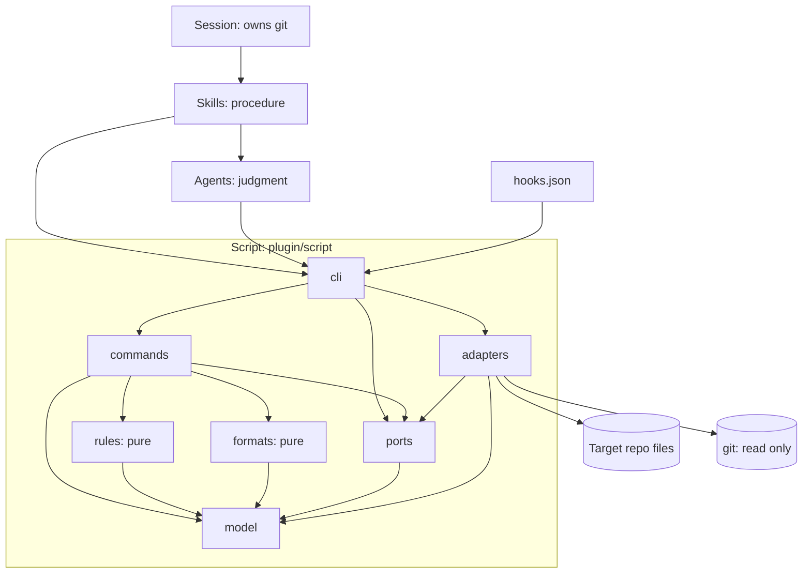
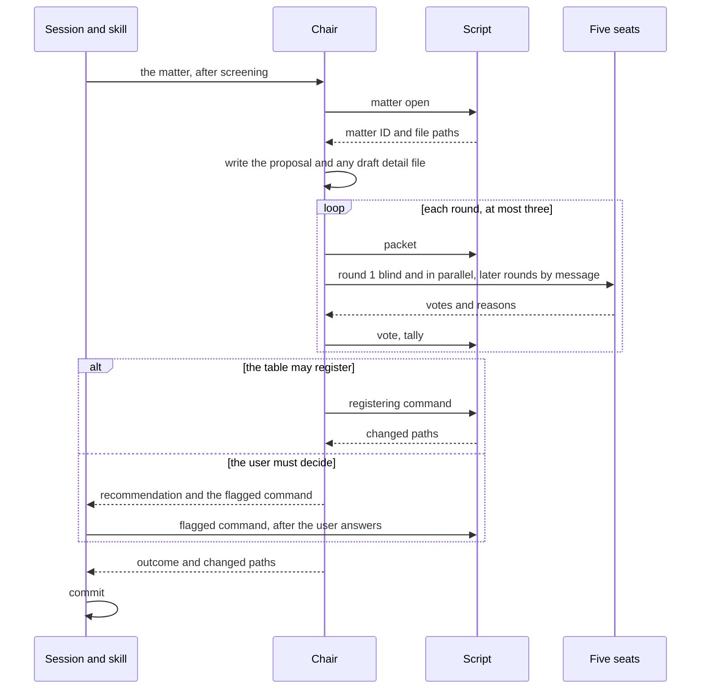
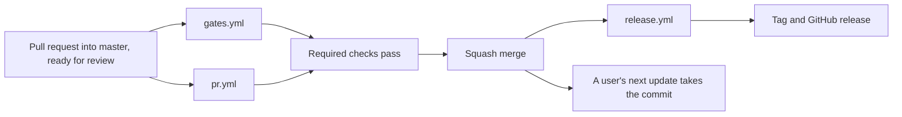

# Architecture Spine — Avalon

This spine fixes what the eight build steps must share so that they cannot build apart.
It is a plan file, and AD-1 says what that means for everything built from it.

Each decision carries one of three marks:

- `[ADOPTED]` restates the user or the sources.
- `[ASSUMPTION]` changes or extends what the user or the sources said. It is this spine's reasoned answer, and it stands until the user changes it. "Answers to the open calls" gives the reason for each one.
- No mark means a design call inside the room the sources leave to architecture.

## Answers to the open calls

The first draft left eight calls open. On 2026-11-11 the user asked that each be reasoned to an answer.
Every answer below is this spine's reasoning, not the user's word. None is open, and each stands until the user changes it.

| # | The call | The answer | Why |
| --- | --- | --- | --- |
| 1 | Is the script one file, or an entry file with a package? (AD-3) | An entry file with a package. | The user's standards came after the sources and outrank them: units that are tested with everything else mocked, sound design, and no grab bag. One file of several thousand lines meets none of them. The sources' "one file named `avalon`" is a naming rule, and it is kept: one name, one entry point, never on the PATH. |
| 2 | Does the rule against citing plans cover pull request text? (AD-1) | Yes, the title and the body. | A squash merge makes them the commit message on `master`, and the release notes list them. Both are permanent. Commits on a branch are not checked, because the squash discards them. |
| 3 | May the spine add script commands? (AD-13) | Yes: `matter open`, `matter wait`, `matter close`, `config set`, `cite fix`, and the name `merge`. | Each one lets a rule that is already adopted be followed. A proposal needs a folder before a packet can be built from it. The config file needs one writer. A citation of a retired ID inside a script-only file needs a writer. The PRD's merge command needs a name. |
| 4 | Squash only, and up to date before merging? (AD-18) | Yes to both. | No gate runs on `master`, so an up-to-date branch is the only check on two pull requests that pass apart and break together. Squash gives one commit for each pull request, which the release walk and answer 2 rely on. |
| 5 | How far does "this repo follows the process from the start" reach? (AD-19) | It starts in build step 1 and covers every law and ADR, the nine core laws included. | Step 1 writes the first laws, so the tree must exist then. The sources already say this repo's own tables ratify the core laws before they ship. The architecture is not built yet, so it is a decision still to be carried out, and the process sends that to a table. The record that this repo uses Avalon is the user's own decision, which the process records with no table. |
| 6 | Is `major` refused below `v1.0.0`? (AD-20) | Yes, until the owner sets a repository variable. | A tag is public and cannot be taken back. The PRD already says the pull request to `v1.0.0` is the first to carry `major`. A variable only the owner can set makes that one deliberate act, at the cost of a few lines of tested code. |
| 7 | Do the chair's script calls prompt the user each time, and what is done about it? (AD-8, AD-9) | They would. Inside a repo that Avalon is set up in, the hook approves a call that runs one of the plugin's own everyday script commands, and nothing else. | The Claude Code docs, read on 2026-11-11, say a skill's pre-approval lasts one turn, and that a subagent's prompts are passed to the user. A round table makes ten or more script calls. The docs also say the user's own deny and ask rules still win over a hook's approval, so the user keeps a switch. The script writes only inside the repo, never to git, and never to the network. A flagged command is never approved this way. |
| 8 | Where do conduct reports go? (PRD) | To the repo's private vulnerability reporting form, marked as a conduct report. GitHub's own abuse report covers a report about a maintainer. | It is private to the maintainers, publishes no address, and needs only a setting the PRD already requires. The owner can replace it with an address at any time, and that is the better long-term answer. PRD FR-51 holds this answer. |

The story breakdown in `_bmad-output/planning-artifacts/epics.md` then raised five more points, and the user asked that each be reasoned to an answer.
That file holds all five answers with their reasons. Three of them change this spine, and each is marked `[ASSUMPTION]` where it lands:

- How the legacy test finds the install (AD-11).
- When the repository settings are applied (AD-18, and Delivery and operations).
- Who proposes at a stand-in table, and how many sittings are planned (AD-19).

## Design Paradigm

**Layered plugin.** Three layers, each with one job. A layer calls its own layer and the layers below it.

| Layer | Job | Lives in |
| --- | --- | --- |
| Skills | Procedure: the steps of a task, run in the session | `plugin/skills/` |
| Agents | Judgment: what is a law, how a line is worded, how a seat votes | `plugin/agents/` |
| Script | Mechanics: every repeatable step, and every write to the record | `plugin/script/` |

The hook is not a fourth layer. It is one command of the script, registered in `plugin/hooks/hooks.json`.

**Hexagonal script.** The script has a pure core and reaches the outside only through ports.

| Script layer | Holds |
| --- | --- |
| `cli` | Arguments, the working directory, standard output and error, and the choice of adapters |
| `commands` | One use case for each command: read, decide, build a change set |
| `rules` | Pure decisions: chains, tallies, the budget, staleness, the legacy test, the path matcher, every lint check |
| `formats` | Pure parse and render of every file format |
| `model` | The data types the other layers share |
| `ports` | Interfaces for files, git, and the clock |
| `adapters` | The real file system, the real git, the real clock |

Each layer is a package of that name under `plugin/script/avalonlib/`.

## Invariants & Rules

Inside the script, a layer may import only the layers its arrows point to.



### AD-1 — Plans are temporary, and nothing permanent cites them [ADOPTED]

- **Binds:** all
- **Prevents:** A permanent file that points at a plan after the plan has been deleted.
- **Rule:**
  - The plan files are everything under `_bmad-output/` (this spine included), `tmp/BRIEF.md`, and `tmp/SPEC.md`. They are removed after the work has landed.
  - No other tracked file names a plan file or uses an ID that a plan defines: `REQ-`, `AC-`, `FR-`, `NFR-`, `OQ-`, `SM-`, `UJ-`, or `AD-` followed by a number.
  - This covers code, tests, comments, skill and agent files, templates, workflows, the README, the community files, and this repo's own Avalon documents. A test is named for the behaviour it proves.
  - The permanent references are this repo's own Avalon documents: its laws by `LAW-` ID, its ADRs, and its design docs (AD-19).
  - A gate scans every tracked text file outside `_bmad-output/`, `tmp/`, and `_bmad/`. It matches an ID only as a whole, case-sensitive token of a prefix and digits. It does not scan `uv.lock`.
  - One file under `devtools/gates/` lists the folders the scan skips. That file, `.gitignore`, `pyproject.toml`, and the markdown lint config are the only tracked files that may name a plan folder.
  - The scan's own tests build their sample IDs at run time and store none.
  - `[ASSUMPTION]` The gate also scans the pull request title and body.

### AD-2 — Judgment in prompts, mechanics in the script [ADOPTED]

- **Binds:** FR-36 to FR-45; all skills, agents, and script commands
- **Prevents:** An agent doing a mechanical step by hand, or the script making a judgment.
- **Rule:**
  - A skill or agent file never does by hand what a script command does, and never restates what a command does. It names the command.
  - The script makes no judgment that the sources leave to agents. It never calls a model.

### AD-3 — One entry file, with the code in a package beside it [ASSUMPTION]

- **Binds:** FR-42, FR-54, NFR-3
- **Prevents:** One file that cannot meet the organisation standards, or a second entry point.
- **Rule:**
  - `plugin/script/avalon` is the only entry point, and it holds no logic. It checks the Python version in syntax every Python 3 can parse, puts its own folder on the import path, turns off bytecode files, and hands over to `avalonlib`.
  - Below Python 3.9 it prints one message that names the version needed, changes nothing, and exits 2. For the `hook` command it prints nothing and exits 0.
  - Every caller runs `python3 "<plugin root>/script/avalon" <command>`. The script is never put on the PATH, and the plugin has no `bin/` folder.
  - A skill treats a missing `python3` as the same stop, with the same message. This replaces the separate Python check that the PRD gives each skill.
  - `avalonlib` imports the standard library and itself only, and it holds no code that branches on the Python version. A gate checks every import.
  - The linter, the type checker, and coverage are configured to include the entry file by name.

### AD-4 — The script's core is pure, and the outside is behind ports

- **Binds:** FR-42 to FR-45, FR-55, FR-56, NFR-5
- **Prevents:** Logic that cannot be unit tested without a file system or git, and a second place that touches either.
- **Rule:**
  - `rules`, `formats`, and `model` do no input or output.
  - `commands` reach files, git, and the time only through `ports`. `cli` alone reads arguments and the working directory, writes the output streams, and chooses adapters.
  - Only the files adapter touches the file system, and only the git adapter starts a process.
  - Nothing under `plugin/script/` imports `socket`, `ssl`, `http`, `urllib`, `ftplib`, `smtplib`, or `asyncio`. A gate checks this and the layer imports in the diagram.
  - The script uses no randomness. An ID or a number is the highest one in use plus one, allocated under the lock.

### AD-5 — A command is one all-or-nothing change set

- **Binds:** FR-7, FR-8, FR-13, FR-19, FR-24, FR-44, FR-60, FR-61
- **Prevents:** A half-written record, a hand edit sealed in by a fresh checksum, and a crash that leaves every later command refusing.
- **Rule:**
  - A command that writes first builds its whole change set in memory: every file to write, move, or delete. It checks the change set, and only then applies it. A refusal changes no file.
  - A writing command holds an exclusive `flock` on `.avalon/lock` from its first read to its last write. The lock ends when the process ends. It covers one working tree.
  - A writing command creates `.avalon/` and the ignore file inside it when they are missing. No other command creates either.
  - Before it applies a change set, the script saves it to `.avalon/journal`. It removes the journal after the last write. A writing command that finds a journal applies it first, under the lock, after it has checked every path in it against the path rules below. `lint` and `status` report a journal and do not apply it, and `hook` ignores it.
  - Each file is replaced atomically. Files under the laws folder go first, and the config file with the new checksum goes last.
  - A command that writes the checksum first verifies the existing one, and refuses on a mismatch. Only `merge` and `migrate` may record a checksum over files that fail it.
  - Version 1.0 has no command that re-records a checksum after a hand edit. The user restores the files from git.
  - A command writes only to the root's tree, `.avalon.yml`, `.avalon/`, and the block in `CLAUDE.md` or `AGENTS.md`. The root is a relative path inside the repo top, with no `..` in it, and outside `.git/`, `.github/`, and `.claude/`. The script resolves symbolic links before it writes, and refuses a target that lands anywhere else.

### AD-6 — Every file format has one home, and one version number

- **Binds:** FR-6 to FR-14, FR-23 to FR-28, FR-33, FR-34, FR-45, FR-60, FR-61
- **Prevents:** The lint and a command disagreeing on a format, two homes for one fixed text, and two plugin versions writing two layouts into one tree.
- **Rule:**
  - `formats` is the only code that parses or renders a governed file, the config file, the block, or a file in a matter folder. Commands, the lint, `migrate`, and `merge` all go through it.
  - A template under `plugin/templates/` is the only home of a format's fixed text. `formats` holds structure and one placeholder form, and it copies fixed text from the template. Every governed document that `scaffold` or a command creates has a template. A file in a matter folder has none. A test renders each format empty and compares it with its template.
  - One parser reads the config file and all frontmatter: flat keys, scalar values, and inline lists. The config writer changes the values of the keys it owns and keeps every other line as it found it. It refuses a file the parser cannot read.
  - `formats` holds one splitter for git conflict markers. `merge`, the version check, and the hook use it.
  - One matcher in `rules` reads every `covers` entry. `*` matches inside one path segment, `**` matches any number of whole segments, and an entry with neither is an exact path. It matches against a list of paths. Git is never given a pattern.
  - **Checksum.** SHA-256 over every regular file under the laws folder whose name does not start with a dot, in byte order of its path relative to the laws folder. Each file adds its path, a NUL, its bytes with every CRLF made LF, and a NUL. Then come the `installed_at` and `install_commit` values as stored, each followed by a NUL. The digest is stored as 64 lower-case hex digits in the `checksum` key. A unit test holds a fixed example and its digest. `move-root` leaves the checksum unchanged.
  - **Version.** The docs format has one integer version, held as a constant in `formats` and written to the config file as `system_version`. The first version is 1. A test keeps a sample of every format and fails when a sample changes and the constant does not.
  - On an older tree, `lint` and `status` parse nothing and report that `migrate` is needed, and every other command but `migrate` and `merge` refuses. On a newer tree every command refuses and tells the user to update the plugin. `merge` runs on a tree whose config file holds conflict markers. It refuses when the two sides hold different versions, and names `migrate` for the older side. On an older tree `lint` exits 1.
  - No format has a field for a person's name, an email address, or an absolute path. A document records a role.
  - `hook` is outside the version check. It guards a tree of any version.
  - `formats/legacy/` holds one frozen reader for each past version. Only `migrate` imports it.

### AD-7 — Each file has one writer [ADOPTED]

- **Binds:** FR-9, FR-11, FR-16, FR-19, FR-28, FR-34, FR-40, FR-43, FR-44
- **Prevents:** Two writers changing the same file or the same part of a file, and a rule with no writer able to follow it.
- **Rule:** A writer not listed for a path does not write it. The last column says what holds the rule. "Prompt" means only the agent's instructions hold it.

| Path in a target repo | Writer | Held by |
| --- | --- | --- |
| Everything under the laws folder | The script | Hook, checksum |
| `.avalon.yml` | The script. The user may edit the caps and the scope list by hand. An agent changes them only with `config set`. | Hook, and the checksum for the install fields |
| The two index files | The script | Lint |
| The block, between its markers | The script | Prompt |
| `CLAUDE.md` and `AGENTS.md`, outside the markers | The user and the session | — |
| ADR file: creation, deletion, the `adr`, `origin`, and `evidence` keys, the changelog section | The script | Lint for the changelog, prompt for the keys |
| ADR file: the `summary` and `covers` keys, and the body | `tech-writer` writes, `prose-editor` edits | Prompt |
| Design doc: the `verified` and `verified_commit` keys | The script | Prompt |
| Design doc: creation, deletion, renaming, every other key, the body, the glossary, the assets folder | `tech-writer` writes, `prose-editor` edits | Prompt |
| The overview, the glossary, and the indexes that `scaffold` seeds | The script, once, at install | — |
| Matter folder: the proposal, each revision, the draft detail file, each round's vote input | The chair | Hook, by file name |
| Everything else under `.avalon/` | The script | Hook |
| The git index, commits, branches, and tags | The session | AD-11 for the script, prompt for agents |

  - `adr new` creates the whole ADR file from the template, with every script-owned key and the first changelog line. For a legacy record it also takes `covers` and `evidence`, because the legacy test needs them first.
  - After `adr new`, the `tech-writer` fills the body, `summary`, and `covers`. The skill then runs `index`, and the change is not complete until `lint` passes.
  - An agent changes an existing ADR or design doc with the Edit tool, never with a whole-file Write.
  - A script command that updates a key reads the file again under the lock, changes only its own keys or section, and keeps the rest. A skill runs `verify` and `index` only after the writing agents have returned.
  - `move-root`, `merge`, and `migrate` may rewrite a link, an ID, or the layout inside any governed file. They change nothing else in a body.
  - A design doc with no stamp has never been verified. `stale` lists it as such, and the lint does not fail on it.
  - `[ASSUMPTION]` A citation of a retired ID inside a script-only region is fixed with `cite fix`. The agent chooses the replacement, or the removal, and the script writes it.
  - A hand edit that flips a script-owned key in an ADR or a design doc is not stopped. The sources place forgery out of scope.

### AD-8 — The hook is a command of the script, and it approves only the plugin's own script [ASSUMPTION]

- **Binds:** FR-20, FR-44, FR-60, NFR-4
- **Prevents:** A guard that resolves paths differently from the script, approves a call it should not, blocks a repo that does not use Avalon, or fails without anyone seeing. It also prevents a round table that stops for the user at every step.
- **Rule:**
  - `hooks.json` holds one `PreToolUse` entry for the Bash, Write, Edit, MultiEdit, and NotebookEdit tools. It runs `python3` with the entry file and `hook` as arguments, with no shell, and with a timeout of 10 seconds.
  - The hook answers `deny`, `ask`, `allow`, or nothing.
  - It answers `allow` only for a Bash command that passes every test below. On any doubt it answers nothing, and the call takes the normal permission flow.
    1. The command is one line, and it holds no unquoted shell operator, substitution, redirect, or variable.
    2. Its first word is exactly `python3`.
    3. Its second word equals the entry file's path under the hook's own plugin root, as text.
    4. Its third word starts a command on the approved list: the Laws, Tables, ADRs, Docs, and Reads groups of the command table.
    5. No word starts with `--as`.
    6. A config file is found above the call's `cwd`.
  - So `scaffold`, `move-root`, `migrate`, `merge`, `config set`, the two confirm commands, and `hook` are never approved. Each takes the normal flow, or AD-9.
  - A skill or agent file holds the plugin root as a placeholder, and Claude Code fills it in before the command reaches Bash. A copy of the script at any other path is outside the approval.
  - The user's own deny and ask rules still win over that approval, and it has no effect in plan mode. The README says so, and says how to turn the approval off with an ask rule.
  - It always exits 0, and its answer travels in the JSON it prints. Claude Code treats exit 2 as a block.
  - For a Write or an Edit, it finds the config file from the nearest existing folder above the target, and also from the call's `cwd`, and applies both. For Bash it uses the `cwd`. With no config file it guards nothing, and it loads nothing beyond what the approval check needs.
  - It compares paths after resolving symbolic links through the deepest existing folder, and after folding case on a volume that ignores case.
  - It reads no git and takes no lock.
  - It denies a Write or an Edit under the laws folder, on `.avalon.yml`, and on any path under `.avalon/` that AD-7 does not give the chair.
  - Its check of a Bash command for a write to those paths is best-effort. It never denies a command that only reads.
  - When the config file cannot be parsed, it protects the laws folder under every root the file names, and under `docs/`.
  - When it fails after a call has matched a protected path or the authority flag, it denies. A failure inside the approval tests answers nothing. Any other failure lets the call through, and the checksum is the second guard.
  - A tool that writes files and is not in the list, such as a tool from an MCP server, is outside the guard.

### AD-9 — The user's authority is a leading flag, and no pre-approval can cover it

- **Binds:** FR-14, FR-20, FR-21, FR-24, FR-44
- **Prevents:** A claimed confirmation that passes without the user seeing it, and builders who disagree on which commands need one.
- **Rule:**
  - The flag is `--as-user`. It comes straight after the entry file and before the command word.
  - These commands need the flag, and the script refuses them without it:
    - `law confirm` and `adr confirm`.
    - A registering command with `--override`, which registers the proposal as the proposer wrote it, decided by `user override`.
    - A registering command with `--accept`, which records the user's acceptance of a table's outcome. The ledger shows it as decided by `table`.
    - A legacy record.
    - `config set`.
    - `matter open` for a table that an agent convenes past the daily cap.
  - The script refuses the flag on any other command.
  - A registering command needs `--accept` when the matter's record shows that the table's outcome is not the user's to skip: a user's proposal that the table reworded or rejected, or an agent-convened change to a `user` or `core` law or a `user` ADR.
  - The hook treats a Bash command as flagged when it names a file called `avalon` and holds a word that starts with `--as`, anywhere in it. It answers `ask` for a flagged command in the permission modes proven to show a prompt. In every other mode, in a mode it does not know, and in any subagent, it answers `deny`, and the reason tells the user to switch to the default mode. It also denies a command that names such a file and that it cannot split into words.
  - One table in the hook's code holds the modes. It starts with `ask` for the default and auto modes, where the docs say a prompt is shown, and with `deny` for the rest. A plugin eval proves each row. A row moves to `ask` only when an eval shows that mode prompts, and to `deny` when one shows it does not.
  - The script's argument parser accepts no shortened flag and no argument file, so the flag has one spelling.
  - No skill or agent file pre-approves a tool. The hook's approval in AD-8 is the only one the plugin gives, and it never covers a flagged command.
  - The chair never runs a flagged command. It returns the exact command line, and the session runs it after the user has answered in that session. A subagent that convened the table passes the return up unchanged.

### AD-10 — Work in progress is a matter, with one folder and one record

- **Binds:** FR-12, FR-15 to FR-22, FR-33, FR-42, NFR-2
- **Prevents:** The chair, the script, and `status` disagreeing on where a proposal and its votes are, what state they are in, and what may be registered.
- **Rule:**
  - `.avalon/` sits at the top of the repo and ignores itself. Nothing in it is part of the record, and no governed document refers to a path inside it. It belongs to one working tree.
  - `matter open` creates the folder and its record, and prints the matter's ID and the absolute path of each file the chair may write. The record holds the kind (law or decision), who proposed it, who convened it, the target if there is one, and the state. Skill and agent files treat the ID as opaque.
  - A matter has three states. `matter open` sets `open`. `matter wait` sets `waiting`, and the chair runs it when the user must decide. An ADR registering command sets `adopted`. A closed matter has no folder.
  - A slate is one matter for each proposal.
  - Screening comes before `matter open`. `matter open` appends one line to `.avalon/tables.log` for a table that an agent convenes, and it refuses past the daily cap without the flag (AD-9).
  - The text of a law or a decision reaches the script only as a file in the matter folder, never as an argument. Other commands take short values as arguments: a changelog summary, a replacement ID, a config value. The proposal is never edited after it is written. The chair writes each revision as a new file.
  - `packet` builds one packet for each round, after the previous round's votes are recorded. A seat reads only its packet.
  - `vote` records one complete round from the chair's input file: five votes, one from each seat that sits on that kind of matter, each with its reason. The script numbers the round and refuses a fourth.
  - The registering commands are `law add`, `law amend`, `law remove`, `law reject`, `adr new`, `adr log`, `adr reject`, and `adr retire`. Each takes a matter ID, except `adr new` for a legacy record. The two confirm commands register nothing new: they need the flag, take no matter, and write a ledger row decided by `user`.
  - One function in `rules` decides whether anything may be registered, and every registering command calls it. It allows four routes:
    1. A table: the matter's last round holds five votes, and AD-9 does not require the user's acceptance. A round of five reject votes registers only as a rejection. A command on this route runs with no prompt, by design, because the table has decided.
    2. The user's override or acceptance, with the flag.
    3. A legacy record that passes the legacy test, with the flag. It has no matter, and the `tech-writer` words its body from what the user and the repo show.
    4. The install: `scaffold` seeds the core laws from the templates and records the install ADR once, under the numbers the sources fix.
  - A registering command takes the text from the matter folder: the latest revision, or the proposal under `--override`.
  - A law command removes the matter folder in its change set. An ADR command keeps it, so that the `tech-writer` can read the adopted text and the reasons. The `adr` skill runs `matter close` after the ADR is written and `lint` passes. `matter close` also removes an abandoned matter.
  - A matter that waits for the user keeps its folder, and `status` lists each matter with its state.

### AD-11 — One module reads git, and nothing writes it [ADOPTED]

- **Binds:** FR-25, FR-26, FR-32, FR-43, FR-55, FR-62
- **Prevents:** A second place that runs git, a read that changes the index, and git code that no test proves.
- **Rule:**
  - The git adapter runs a fixed list of read-only git commands and nothing else. They answer: the top of the repo, the current commit, whether the clone is shallow, the tracked files, the uncommitted changes, the paths that existed at a commit, the commits that changed a path, the commit that added a path with its first parent, and a file's content at a commit.
  - It runs git with optional locks off, so that a status read cannot refresh the index.
  - `[ASSUMPTION]` No rule computes from a commit ID that a file stores, because a squash merge or a rebase can leave that commit outside the history. `stale` uses the commit in which a stamp landed, as the sources say. The legacy test reads the repo as it stood before the install landed: at the first parent of the oldest commit reachable from `HEAD` that added the config file, or at `HEAD` while the config file is not committed. Where that commit has no parent, nothing is legacy.
  - The recorded install commit stays a record of what `scaffold` ran on. It is written once, and the checksum covers it.
  - Every other layer sees git only as the git port.
  - `merge` reads conflict markers from the files. It does not read git.
  - The contract suite is the only test code that runs this adapter (AD-15). It also checks that the index, `HEAD`, and every ref are unchanged after every call.

### AD-12 — One resolver finds the config file and the root

- **Binds:** FR-22, FR-31 to FR-33, FR-44, NFR-4
- **Prevents:** The script, the hook, and a skill working on different folders.
- **Rule:**
  - The repo top is the nearest folder, walking up from the working directory, that holds `.avalon.yml`. `scaffold` alone asks git for it, because no config file exists yet.
  - The root comes from the config file. The script reads no environment variable and no plugin option. `init` passes the plugin's `default_root` option to `scaffold` as an argument, and the skill, not the script, checks the nesting depth setting.
  - `scaffold` refuses a root that holds content it did not create, and names another root. `init` offers that root to the user. Content is Avalon's own when a config file names that root.
  - With a config file present, `scaffold` changes only the block and what is missing. It never changes the install time or the install commit.
  - A path in the config file or in `covers` is relative to the repo top, with forward slashes. A link inside a document is relative to that document.
  - Skill and agent files never hold a root path. They ask the script, or read the block.
  - A fixture is never used in place. A test or an eval copies it to a temporary folder outside this repo. Only the contract suite and the evals give the copy a git repo.

### AD-13 — The script's interface is closed, and a test holds prompts to it

- **Binds:** FR-36 to FR-45
- **Prevents:** A skill or agent file quoting a command that does not exist, or misreading a result.
- **Rule:**
  - The command names are exactly the table in the Structural Seed. `[ASSUMPTION]` That table marks the ones this spine adds.
  - Exit codes: 0 for success, 1 when `lint` finds a failure, 2 for a refusal or a usage error. A warning does not change the exit code. `hook` always exits 0.
  - Output is lines of `key: value`, then a block headed `changed:` with one path on each line, marked `+`, `~`, or `-` for added, changed, and deleted. The paths are relative to the repo top and leave out `.avalon/`. A command that creates something prints its ID. A read command prints one record on each line.
  - An error goes to standard error, says what was refused and why, and names the next command to run.
  - A matter ID is the first argument after the command.
  - No command prompts, pages, or colours its output. Only `hook` reads standard input.
  - Arguments and flags beyond these are settled when each command is built. A prompt quotes only a command that exists, so the chair file gains its decision steps in the build step that adds the `adr` commands.
  - A skill or agent runs a script command alone, as one Bash call, so that the hook can approve it (AD-8).
  - A skill or agent file writes a script command on one line, starting with `python3 "${CLAUDE_PLUGIN_ROOT}/script/avalon"`, with any placeholder in angle brackets. A test finds every such line, fills the placeholders, and parses it with the real argument parser.

### AD-14 — Each piece of prompt text has one home

- **Binds:** FR-15 to FR-22, FR-29, FR-30, FR-36 to FR-41
- **Prevents:** Two prompt files that state the same rule and drift apart, and an agent with a tool it should not have.
- **Rule:**
  - The chair file is the only home of the round-table procedure, the voting rules, and what a seat returns. The chair passes them to each seat. The key names of a votes file live only in `formats`.
  - A seat file holds its perspective and its questions, and nothing else.
  - The `law-reviewer` file is the only home of the findings format, with its three confidence levels.
  - The writing standard is read from the target repo's laws folder. The chair reads the detail file template from the plugin. No skill or agent file holds a copy of either.
  - Tools: a seat has Read, Grep, and Glob. The `law-reviewer` adds Bash. The `prose-editor` adds Edit. The `tech-writer` adds Write, Edit, and Bash. The chair has Read, Grep, Glob, Write, Bash, Agent, and SendMessage.
  - A tool list cannot limit an agent to a path. The hook is the only path guard, and AD-7 says where only the prompt holds a rule.
  - Every agent returns its outcome and the paths it changed. The chair also returns the matter ID, any command the session must run (AD-9), and its recommendation when a matter waits.
  - No agent commits.

### AD-15 — Five suites, each with a fixed reach

- **Binds:** FR-55, FR-56, FR-58
- **Prevents:** A test of one kind quietly reaching what that kind may not.
- **Rule:**

| Suite | Folder | May reach | Run |
| --- | --- | --- | --- |
| Unit | `tests/unit/` | One unit, with every port faked | Its own run, within the time budget |
| Integration | `tests/integration/` | The real file system, in a temporary folder, with git faked | Its own run |
| End-to-end | `tests/e2e/` | The whole command line and the hook, in process, on a temporary folder, with git faked | Its own run |
| Contract | `tests/contract/` | Real git, in a throwaway repo | Its own run |
| Plugin evals | `evals/` | Claude Code, a model, and a copy of a fixture | Its own gate |

  - One shared guard makes any process start and any network connection fail in the first three suites.
  - The fakes for the ports live in `tests/fakes/`. The contract suite runs each git fake and its real adapter through the same cases. That covers the git adapter in `devtools/` too.
  - `tests/` mirrors the code it tests: `tests/unit/script/` and `tests/unit/devtools/`. The test runner puts `plugin/script/` on its import path.
  - An end-to-end test runs the entry file in process, including its two paths for an old Python.
  - Coverage is measured once, on the current Python, from the unit and integration runs together, over `plugin/script/` and `devtools/`. The floor is 80. The git adapters and the `gh` adapter are left out of the measure, because the contract suite and the dry run in `pr.yml` are what prove them.
  - The first four suites also run on Python 3.9. That run, and not the type checker, proves the floor. Tests use only what both pytest versions in the Stack share.

### AD-16 — The plugin folder holds what a user installs, and nothing else

- **Binds:** FR-31, FR-46, FR-49, FR-52, FR-53, FR-62, NFR-3, NFR-5
- **Prevents:** A test, a fixture, a plan, or a development dependency reaching a user's machine.
- **Rule:**
  - `plugin/` is self-contained. Nothing in it imports or reads a path outside it.
  - Tests, fixtures, eval cases, development tools, and workflows live outside `plugin/`. The eval run names `evals/` explicitly.
  - The marketplace file at the repo top names `./plugin`. The plugin manifest sets no version.
  - No tracked file stores the plugin's installed path, which changes with every update.
  - A release publishes a tag and a GitHub release, and no built file. The CI recipe for a target repo takes `plugin/script/` at a release tag.
  - Development tools are declared in the top-level `pyproject.toml` and locked in `uv.lock`. Nothing under `plugin/` needs them.

### AD-17 — Workflows call tested code and hold no logic

- **Binds:** FR-47, FR-53, FR-56, FR-58, FR-59
- **Prevents:** Untested logic in a workflow file, which the standards would not reach.
- **Rule:**
  - A workflow file sets triggers, permissions, and steps that call a command.
  - A job's `if:` takes one of three forms only: the draft test, `always()` with the draft test on the final job, or a test of an output that a `devtools` command set. A gate reads every workflow and fails on any other form.
  - Anything that computes or branches is Python under `devtools/`, written to the same standards and tested in the same suites. That covers the next version, the label check, the scan of tracked files, the changed-path filter, and the final job's verdict.
  - The scan of tracked files also fails on a path inside a person's home folder.
  - `devtools/` reaches GitHub through one adapter that runs `gh`, and reaches git through one adapter of its own, because the script's git list is closed (AD-11). Tests fake both.
  - Every action is pinned to a full commit SHA. Every workflow states its permissions, and only the release job may write.
  - `_bmad/`, `_bmad-output/`, and `tmp/` are outside every gate, and nothing imports from them.

### AD-18 — Two workflows gate a pull request, and one job gives the verdict [ADOPTED]

- **Binds:** FR-58, FR-59
- **Prevents:** Gates that run on drafts or on `master`, fork code that runs with a secret, and a required check that passes without running.
- **Rule:**
  - `gates.yml` runs on `pull_request` into `master`, for opened, reopened, new commits, and ready for review. Every job skips a draft.
  - Its jobs are: the four test suites on each operating system and Python in the Stack; the linter, the formatter, the type checker, and coverage; the markdown lint; `claude plugin validate`; the secret scan; the scan of tracked files (AD-1, AD-17); the Avalon lint on this repo's own docs, once the script can run it; and the plugin evals, when a change touches a skill, an agent file, the hook, or a template.
  - `pr.yml` runs on the same events, and on a label change or an edit to the title or body. It checks that the pull request carries exactly one of `major`, `minor`, and `patch`, scans the title and body (AD-1), and runs the release code in dry-run mode to show the version this pull request would get.
  - Each workflow has its own concurrency group for each pull request, and a newer run cancels the older one.
  - No workflow uses `pull_request_target`.
  - A gate that applies only to some changes is a job with a condition, not a workflow with a path filter.
  - The final job of `gates.yml` skips a draft, like every other job. On any other run it runs with `always()`, and it fails unless every other job succeeded, or was skipped because the changed-path filter said it did not apply. A fork's pull request that needs the evals therefore fails until a maintainer moves it to a branch of this repo.
  - `[ASSUMPTION]` A ruleset on `master` requires a pull request, the final job, the `pr.yml` job, and a branch that is up to date. It allows squash merges only, and the squash message is the pull request's title and description. So each pull request is one commit on `master`, with a message the gate has scanned.
  - `[ASSUMPTION]` The ruleset comes on in stages. The parts that need no workflow are on before the first pull request. A job becomes a required check once the pull request that adds its workflow has merged, because a required check that never reports blocks every merge.
  - Until a gate exists, a pull request states which of that gate's checks its author ran by hand.

### AD-19 — This repo follows the Avalon process from its first document [ADOPTED]

- **Binds:** FR-47, FR-48, FR-51
- **Prevents:** A permanent record that begins with documents no round table heard, and a rule that lives only in a plan.
- **Rule:**
  - From build step 1, this repo is an Avalon target with the root at `docs/`. Its laws, ADRs, and design docs are the only lasting home of a rule, a decision, or a description.
  - Every law and every ADR of this repo goes to a round table before it is written, including those written before the plugin can run. The procedure is the planned one: a chair who is not the proposer, five seats, a blind first round, at most three rounds, the chair's decision, and a ledger row.
  - Until the chair and seat files exist, stand-in subagents take those roles, each briefed for its role and run on its planned model. Until the script exists, the stand-in chair writes the records by hand, in the final formats, and only after the table has decided.
  - A design doc gets a writing pass and an editing pass against the writing standard, by stand-ins until the two agents exist.
  - The user's authority is unchanged. A table that would reword or reject the user's proposal registers nothing until the user answers.
  - `[ASSUMPTION]` The tree is created by hand at the start of step 1, as an install would create it. The nine core laws are seeded as drafts under their own IDs, and this repo's own laws take the IDs after them. The config file is written by hand too. Its install commit is the commit the tree is created on, and it has no checksum until the script records one.
  - `[ASSUMPTION]` A table ratifies each core law in step 2, when the writing standard exists. Until that table decides, a core law is a draft. The table's wording replaces the draft under the same ID, once, with a ledger row. After that, a change is an amendment. The ratified wording becomes the template. The user is the proposer of each core law, so a table that would reword one registers nothing until the user accepts.
  - `[ASSUMPTION]` The architecture of this repo goes to a table before the code that follows it, and becomes `0001-architecture.md`. The record that this repo uses Avalon is the user's decision. It becomes `0002-documentation-system.md` with no table, as the process has it.
  - Each decision in this spine that must outlive the plans is proposed to a table in its own words, with no plan ID.
  - `[ASSUMPTION]` A record carries the origin of whoever proposed it. A call the user stated goes to the table as the user's proposal. A call the planning work reasoned goes as an agent's, and the session then offers the user the table's outcome to confirm. A confirmation makes the origin `user`, as the process has it. An ADR that mixes the two is an agent's until the user confirms it.
  - `[ASSUMPTION]` A stand-in table hears related proposals as a slate. Build steps 1 and 2 are planned as five sittings: the standards that are laws, the architecture, the tooling and delivery decisions, the writing standard, and the other eight core laws. A chair may split a slate that is too large for one packet. A sixth sitting, and each one after it, needs the user's go-ahead first.
  - These tables are convened at the user's direction, so the daily cap does not count them.
  - The install time and commit are recorded when the tree is first created. A decision that the repo had already carried out by then is recorded only as a legacy decision, under the legacy test. A decision not yet carried out, such as the architecture, goes to a table.
  - When the script can run, its `lint` checks the hand-written tree, and the checksum is recorded once, with the user's approval. From then on the script writes every record, and nothing under the laws folder is written by hand.
  - `CONTRIBUTING.md` and the README point to a law or a design doc. They do not restate one.
  - The plans are deleted only after their lasting content is in this repo's documents and the user agrees.

### AD-20 — The release workflow catches up, tags, and writes nothing else

- **Binds:** FR-52, FR-59
- **Prevents:** A merge that never gets a release, a version made twice, a tag with no release, and a push to `master` from a workflow.
- **Rule:**
  - `release.yml` is the only workflow that runs on a push to `master`. Runs share one concurrency group and never cancel a run in progress.
  - Each run releases every commit on `master` that is newer than the latest version, oldest first. For each one it finds the merged pull request and reads the label it carries at that moment.
  - The latest version is the highest `vMAJOR.MINOR.PATCH` among tags of exactly that form, compared as numbers.
  - A version is made in one call that creates the tag at that commit and the GitHub release with its notes. A commit is released when a GitHub release exists for its tag.
  - A commit with no merged pull request gets no release of its own. It ships in the next one.
  - A pull request with no single version label stops the run. A maintainer corrects the label and runs it again.
  - The workflow never pushes a commit. A run is safe to repeat.
  - With no version in the repo, the first run releases only the newest commit, counting from `v0.0.0`.
  - `[ASSUMPTION]` While the latest version is below `v1.0.0`, the release code refuses `major` unless a repository variable that the owner sets allows it. `pr.yml` shows the refusal before the merge.
  - A bad release is undone by a pull request that reverts it, which releases again.

## Consistency Conventions

| Concern | Convention |
| --- | --- |
| Names in a target repo | `LAW-` and six digits. `NNNN-topic.md` for an ADR. Lower-case file names with hyphens for design docs. |
| Names in the plugin | Skills: `init`, `intake`, `law`, `adr`, `design`, `check`, `sync`, each in a folder of that name, with no `name` key. Agents: `chair`, `seat-<name>`, `law-reviewer`, `tech-writer`, `prose-editor`, flat in `plugin/agents/` and spawned as `avalon:<agent>`. |
| Names in code | Modules and functions in snake case. One module for each command group, each format, and each port. No folder named `utils`, `helpers`, `misc`, or `common`. |
| Tests | `test_<behaviour>`, with Arrange, Act, and Assert in that order. |
| Text files | UTF-8, line feeds, one final newline. |
| Dates and times | A date in a document is the local date, as `YYYY-MM-DD`. The install time is UTC, in ISO 8601 with a `Z`. Both come from the clock port. |
| Config keys | Flat, in snake case. The script owns `root`, `profile`, `system_version`, `installed_at`, `install_commit`, and `checksum`. The user owns `scopes` and the caps. |
| Caps and their defaults | `law_cap: 100`, `law_length_cap: 200`, `doc_line_cap: 400`, `diagram_node_cap: 15`, `image_kb_cap: 500`, `sentence_word_flag: 40`, `daily_table_cap: 5`. |
| Matter files | The record and each round's votes are JSON. The proposal, a revision, and the draft detail file are Markdown. |
| Logging | None. The script keeps no log and sends nothing anywhere. |
| Skill files | Under 500 lines, with longer reference text in a file beside the skill. |
| Workflows | Runner labels are pinned. Each job installs the development tools from the lock file. |

## Stack

Each version was read from the tool's own registry or release page on 2026-11-11.

| Name | Version |
| --- | --- |
| Python, lowest the shipped script runs on | 3.9 |
| Python, current release line the gates also run on | 3.15 |
| Git, lowest the plugin evals accept | 2.31 |
| Claude Code, at authoring and in the gates (the lowest supported version is measured in build step 4) | 2.1.322 |
| Agent models, by alias in each agent file | `opus`, `sonnet` |
| uv | 0.13.7 |
| pytest, on Python 3.10 and later | 9.2.0 |
| pytest, on Python 3.9 | 8.4.2 |
| coverage, on Python 3.11 and later | 7.17.2 |
| coverage, on Python 3.9 | 7.10.7 |
| ruff, as linter and formatter, with target `py39` | 0.17.4 |
| mypy, at its lowest target, 3.10 | 2.4.1 |
| markdownlint-cli2 | 0.24.0 |
| Node, for markdownlint-cli2 | 22 |
| actions/checkout | v7.0.1 |
| actions/setup-python | v7.1.0 |
| astral-sh/setup-uv | v10.3.3 |
| actions/setup-node | v7.1.0 |
| Linux runner | ubuntu-24.04 |
| macOS runner | macos-26 |
| GitHub CLI | The one on the runner image |

## Structural Seed

### The repo

```text
.claude-plugin/marketplace.json   names ./plugin
plugin/                           what a user installs
  .claude-plugin/plugin.json      name, licence, the default_root option; no version
  skills/<skill>/SKILL.md         seven skills
  agents/<agent>.md               ten agent files, flat
  hooks/hooks.json                one PreToolUse entry
  script/
    avalon                        entry file
    avalonlib/                    cli, commands, rules, formats, model, ports, adapters
  templates/                      one for each governed document the script creates
  LICENSE                         so an installed copy carries the licence
tests/
  unit/  integration/  e2e/  contract/  fakes/
evals/                            plugin eval cases
fixtures/                         code-repo, library, story-bible
devtools/
  gates/  release/                tested Python that the workflows call, and the scan's skip list
.github/workflows/                gates.yml, pr.yml, release.yml
.github/dependabot.yml            updates for the pinned actions and the locked tools
.avalon.yml                       this repo's own config file
docs/                             this repo's laws, ADRs, and design docs, from build step 1
LICENSE  README.md  CONTRIBUTING.md  CODE_OF_CONDUCT.md  SECURITY.md
pyproject.toml  uv.lock           development tools only
.markdownlint-cli2.jsonc          the markdown lint config
_bmad/  _bmad-output/  tmp/       planning tools and plans; temporary
```

### The script's commands

| Group | Commands | Writes | Note |
| --- | --- | --- | --- |
| Tree | `scaffold`, `move-root`, `migrate`, `merge` | Yes | `merge` is this spine's name for the PRD's merge command |
| Config | `config set` | Yes | Added by this spine. Needs the flag. |
| Laws | `law add`, `law amend`, `law remove`, `law reject`, `law confirm` | Yes | `law confirm` needs the flag |
| Tables | `matter open`, `matter wait`, `matter close`, `packet`, `vote`, `tally` | `.avalon/` only | `matter` is added by this spine |
| ADRs | `adr new`, `adr log`, `adr reject`, `adr retire`, `adr confirm` | Yes | `adr confirm` needs the flag |
| Docs | `index`, `verify`, `cite fix` | Yes | `cite fix` is added by this spine |
| Reads | `status`, `lint`, `stale`, `for` | No | |
| Guard | `hook` | No | |

### Working state in a target repo

The sources fix the docs tree. This is the part they leave open.

```text
.avalon.yml                  tracked
.avalon/                     ignores itself; one working tree
  .gitignore
  lock
  journal                    present only during a write, or after a crash
  tables.log                 one line for each table an agent convened
  matters/<matter-id>/
    matter.json              the script: kind, proposer, convener, target, state (open, waiting, adopted)
    proposal.md              the chair; never edited after it is written
    revision-<round>.md      the chair
    detail.md                the chair, for a law that needs a detail file
    input-<round>.json       the chair: one round's votes and reasons
    packet-<round>.md        the script
    votes-<round>.json       the script
```

### A round table

The sequence shows who calls whom, and where the user's authority enters.
The fifth seat is the Enforcer for a law and the Scout for a decision.



### Delivery and operations

The flow shows the only path from a change to a user.



- Avalon has no server and no environment to deploy. The public GitHub repo is the only way it is distributed.
- Code runs in two places: a user's machine, and GitHub's hosted runners.
- The gates run the first four suites on Ubuntu and macOS, on Python 3.9 and on the current release. On Ubuntu the runner installs 3.9. On macOS the 3.9 run uses the system interpreter, and `uv` is told not to download one. Each 3.9 job first checks that its interpreter reports 3.9, and fails if it does not.
- The lint, format, type, and coverage gates run once, on Ubuntu and the current Python.
- The plugin evals run with a cost limit. Their model credential is a repository secret.
- The owner applies the repository settings in build step 1, in three stages.
  - Before the first pull request: a pull request is required, merges are squash only with the pull request's title and description as the message, the three version labels exist, and private vulnerability reporting is on.
  - With each workflow: its job becomes a required check, and the up-to-date rule comes on with the first.
  - At the end of the step: the secret for the evals is stored. Only the owner enters its value.
- A design doc of this repo records each setting and the command that applies it. An agent runs such a command only after the owner approves it.
- Dependabot proposes updates to the pinned actions and the locked tools, each as a pull request with the `patch` label.
- The README tells a user what the hook approves, what it denies, and how to turn the approval off. It warns against a broad allow rule for the script, which could cover a flagged command.
- Nothing is monitored, because nothing is collected.

## Capability → Architecture Map

| Capability / Area | Lives in | Governed by |
| --- | --- | --- |
| The document model, kinds, and precedence (PRD 4.1) | `templates/`, the block, the core laws | AD-2, AD-6 |
| Laws, the registry, the archive (PRD 4.2) | `commands`, `rules`, `formats` for laws | AD-5, AD-6, AD-7 |
| The ledger and the tally (PRD 4.3) | `formats` and `rules` for the ledger | AD-5, AD-6, AD-10 |
| The round table (PRD 4.4, NFR-2) | `skills/law`, `skills/adr`, the chair, the seats, the table commands | AD-9, AD-10, AD-14 |
| ADRs (PRD 4.5) | `commands` for ADRs, `skills/adr`, `tech-writer` | AD-7, AD-10, AD-11 |
| Design docs, the glossary, the indexes (PRD 4.6) | `commands` for `index`, `stale`, `verify`, `for`; `skills/design` | AD-6, AD-7, AD-11 |
| The writing standard (PRD 4.7) | `templates/`, the lint checks in `rules`, `prose-editor` | AD-14 |
| Setup, layout, loading, conflicts (PRD 4.8, NFR-1) | `scaffold`, `move-root`, `skills/init`, the block | AD-6, AD-12, AD-16 |
| Skills and supporting agents (PRD 4.9) | `plugin/skills/`, `plugin/agents/` | AD-2, AD-13, AD-14 |
| The script, the guards, the lint (PRD 4.10) | `plugin/script/`, `plugin/hooks/` | AD-3, AD-4, AD-5, AD-8, AD-13 |
| Building and proving Avalon here (PRD 4.11) | `fixtures/`, `evals/`, `docs/` | AD-12, AD-15, AD-19 |
| The public repo and its releases (PRD 4.12) | The files at the repo top, `.github/`, `plugin/.claude-plugin/` | AD-16, AD-17, AD-20 |
| Standards, gates, releases (PRD 4.13) | `tests/`, `devtools/`, `.github/workflows/` | AD-15, AD-17, AD-18, AD-20 |
| Merges, upgrades, CI in a target repo (PRD 4.14) | `merge`, `migrate`, the CI recipe in the README | AD-5, AD-6, AD-11, AD-16 |
| No dependencies, no collisions, no data collection (NFR-3 to NFR-5) | `plugin/script/` | AD-3, AD-4, AD-12, AD-16 |

## Deferred

Each item names the build step that settles it.

- **Arguments and flags of each command, beyond AD-9 and AD-13.** The step that builds the command.
- **Module names inside each script layer, and the format of a matter ID.** Step 3. One step owns each.
- **The hook's rules for spotting a write inside a Bash command.** Step 4. One module, best-effort by design.
- **Proof of each row in the permission mode table, of the hook's approval inside a subagent, and that a script command reaches Bash with the plugin root filled in.** Step 4, by plugin eval (AD-8, AD-9).
- **How the hand-written tree of this repo gets its first checksum.** Step 3. It happens once, with the user's approval, through the script's own checksum code, and no shipped command does it.
- **The steps inside `migrate`.** The first release that changes a format.
- **How the CI recipe fetches `plugin/script/`.** Step 8.
- **The tool for the secret scan.** Step 1, when the gates are built.
- **Whether the macOS runner's system interpreter is Python 3.9, and whether Dependabot handles the lock file.** Step 1. Neither is confirmed by the vendors' docs. If the system interpreter is not 3.9, the run installs 3.9 on a macOS runner that has a build of it, and the Stack is corrected.
- **Model and effort for each agent.** Steps 4 to 7, tuned on the fixtures.
- **Eval cases and their scoring.** Steps 4 to 7. The PRD sets the thresholds.
- **What the release notes hold beyond the generated list.** Step 1, with the release workflow.
- **A dedicated address for conduct reports.** Whenever the owner supplies one. Until then, answer 8 stands.
