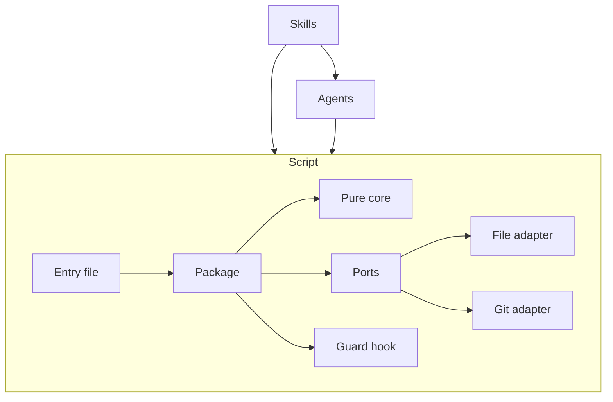

# ADR-0001: Architecture

## Context

Avalon is a Claude Code plugin. It is built from three layers: skills, agents, and one script. Skills hold procedure. Agents hold judgment. The script holds mechanics.

The script has a core, ports, and adapters. The guard hook is a command of the script. The plugin folder holds everything a user installs. Tests, fixtures, eval cases, development tools, and workflows live outside it.

The primary technologies are:

- the Claude Code plugin format
- Python, standard library only, version 3.9 and later (the reason for the floor is unknown)
- Markdown documents
- git, read-only

The diagram shows the three layers, which layer may call which, and the parts inside the script.

## Decision

### Judgment in prompts, mechanics in one script

- Agents and skills hold procedure and judgment: what is a law, how a line is worded, how a seat votes.
- One script does every repeatable step and every write to the record.
- The script never calls a model.
- A skill or agent never does a step by hand when a script command does it. It names the command instead.
- Before the plugin's agents exist, ADR-0002 applies and this rule does not.

### A plugin of three layers in a self-contained folder

- Avalon is a Claude Code plugin with three layers.
- Skills hold procedure and sit on top. Agents hold judgment and sit in the middle. The script holds mechanics and sits at the bottom.
- A skill may call agents and the script. An agent may call the script. The script calls neither.
- The guard hook is a command of the script, not a fourth layer.
- The plugin is installed from the public repo, has no server, and collects nothing.
- The plugin folder holds the script, its templates, and everything else a user installs. It loads no code or data from outside its own folder, except the files of the repo it governs.
- Tests, fixtures, eval cases, development tools, and workflows live outside the plugin folder.

### The script is Python on the standard library only

- The script has one entry file that holds no logic and hands over to a package.
- The package imports only the standard library and itself, and opens no network connection.
- It runs on Python 3.9 and later.

### A pure core, with files, git, and the time behind ports

- The script's decisions, parsing, and rendering do no input or output.
- Commands reach files, git, and the time only through ports.
- Only the real file adapter touches the file system. Only the real git adapter starts a process.
- One part of the script reads the arguments and chooses the adapters.

### A writing command is one all-or-nothing change set

- One module carries out every write, and every writing command calls it.
- A command that writes builds its whole change set in memory and checks it, then applies the set as one all-or-nothing change.
- It holds one exclusive lock for its whole run.
- The config file, with its new checksum, is written last.
- A refusal changes no file.
- Before a command reads or writes, it repairs any unfinished change set it finds. If it cannot repair the set, it refuses.

### One home for each format, one writer for each file

- One module parses and renders every governed file.
- A template is the only home of a format's fixed text.
- Every file under the record has one named writer: the script, the chair, the tech writer, the prose editor, or the user. A writer not named for a path does not write it.
- Naming the user as a writer gives no leave to edit the laws folder outside a round table (LAW-000003).
- Before the plugin's agents exist, the stand-in chair is the named writer, as ADR-0002 provides.

### A hook guards the record

- The guard hook denies direct writes by any tool, the shell included, to the laws folder, the config file, and the script's working files.
- It approves only a closed list of the plugin's everyday commands.
- It never approves a flagged command ahead of time.
- Before the plugin's agents exist, ADR-0002 applies.

### The user's authority is one leading flag

- The script refuses a command that needs the user's authority unless it carries one leading flag.
- Only the user runs a flagged command. No agent or skill runs one.
- The flag guards against mistakes. It is not a security boundary.
- The flag never takes the place of a round table where a law requires one.

### One module reads git, and nothing writes it

- The git adapter is one module. It runs a fixed list of read-only git commands.
- No agent and no script command commits, branches, or tags.
- The session that asked for the work owns git.

## Consequences

- The rule that the script never calls a model is the hardest part of the first decision to reverse.
- Allowing a git write later is a small change, but it breaks the rule above and so needs a round table.
- Any change to the minimum Python version, or admitting a third-party dependency, goes through a round table.
- The plugin-folder boundary sets the install layout, so it is costly to reverse.
- Once an on-disk change-set format exists, undoing the all-or-nothing rule is hard.
- The flag becomes part of the command interface that skills and users call, so it is costly to change.
- Ports are cheaper to adopt at the start than to retrofit later.
- Design docs describe these once the code exists:
  - the journal and repair of a change set
  - the lock, and a stale lock
  - atomic replacement per file
  - what a user sees when the lock is held
  - the text a refused command prints
  - why the script is never put on the PATH
  - how the config file is parsed without YAML
  - how the script finds the config file and the root
  - the closed lists of commands, exit codes, and everyday commands
  - where each piece of prompt text lives
  - manifest and marketplace details

## Alternatives rejected

- **Rejected: agents do the mechanical steps themselves.** The reason is unknown.
- **Rejected: a script that calls a model.** The reason is unknown.
- **Rejected: the script commits its own changes.** The reason is unknown.
- **Rejected: several modules call git.** The reason is unknown.
- **Rejected: a standalone command-line tool.** The reason is unknown.
- **Rejected: instructions only, with no script.** The reason is unknown.
- **Rejected: one root with everything together, filtered at install.** The reason is unknown.
- **Rejected: one file of several thousand lines.** The reason is unknown.
- **Rejected: a package with third-party dependencies.** The reason is unknown.
- **Rejected: a different language, with none named.** The reason is unknown.
- **Rejected: commands call the file system and git directly.** The reason is unknown.
- **Rejected: write each file as the command goes.** The reason is unknown.
- **Rejected: no lock.** The reason is unknown.
- **Rejected: replace each file atomically, with no recovery for the whole set.** A crash between two files leaves part of a set written.
- **Rejected: each command parses and writes its own files.** The reason is unknown.
- **Rejected: no template, with fixed text in code.** The reason is unknown.
- **Rejected: no hook, relying on instructions and the checksum.** The reason is unknown.
- **Rejected: approving the script's commands ahead of time through a skill setting.** The reason is unknown.
- **Rejected: a confirmation prompt.** The reason is unknown.
- **Rejected: an environment variable.** The reason is unknown.

## Changelog

- 2026-11-12 (agent, table): Created. Recorded the plugin's form, its parts and their boundaries, and its technologies.
- 2026-11-12 (user, table): Added the split of judgment and mechanics, and the rule that one module reads git and nothing writes it.
- 2026-11-12 (user): Confirmed the decisions of this ADR.
